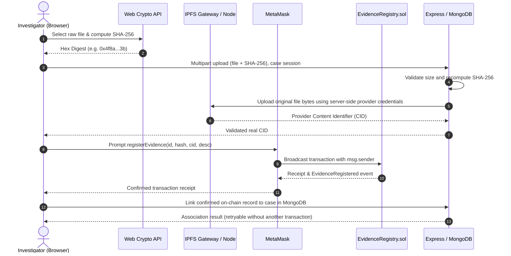
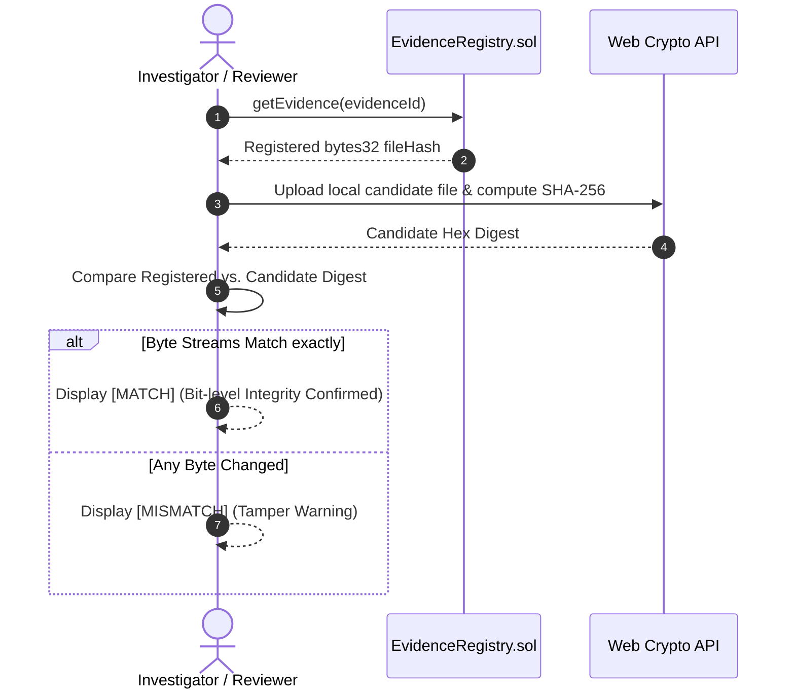

# ChainProof: System Architecture & Technical Operational Guide

**Decentralized Digital Evidence Integrity and Chain-of-Custody Management System**  
*A Blockchain and IPFS-Based Approach to Tamper Detection and Secure Evidence Tracking*

---

## 1. Executive Summary & Purpose

In traditional digital forensics and judicial workflows, proving the authenticity and custody trail of digital evidence presents fundamental challenges:
- **Bit-rot & Tampering:** Digital files can be trivially altered, metadata modified, or timestamps spoofed without leaving physical traces.
- **Vulnerable Centralized Logs:** Traditional custodial tracking relies on centralized databases or paper forms susceptible to unauthorized alteration, administrative compromise, or insider threat.
- **Verification Ambiguity:** Proving that an artifact in court today matches the exact bytes seized months or years ago often depends on trust in human testimony rather than mathematical proof.

**ChainProof** solves this by establishing a verifiable, tamper-evident audit trail anchored in Ethereum-compatible smart contracts, client-side cryptographic hashing, decentralized content addressing (IPFS), and an access-controlled case workstation.

> **Forensic Scope Disclaimer:**  
> ChainProof verifies **byte-for-byte integrity from the moment of registration onward**. It does not independently guarantee the initial origin, authenticity, or legal admissibility of a file prior to registration, nor does it make data uploaded to public IPFS gateways confidential. Sensitive case materials must be encrypted prior to IPFS publication or pinned to private clusters.

---

## 2. High-Level System Architecture

ChainProof divides responsibilities cleanly across four interconnected architectural layers:

```text
┌────────────────────────────────────────────────────────────────────────┐
│                        FORENSIC WORKSTATION (REACT)                    │
│  - Case Access Portal (/)          - Integrity Verifier (SHA-256)      │
│  - Case Workspace (/workspace/...) - Chain of Custody Timeline         │
│  - EIP-1193 MetaMask Integration   - Forensic Certificate Generator    │
└──────────────────┬─────────────────────────────────┬───────────────────┘
                   │ HTTPS / REST (JWT Session)      │ Web3 RPC / EIP-1193
                   ▼                                 ▼
┌─────────────────────────────────────┐  ┌───────────────────────────────┐
│       BACKEND API (EXPRESS/TS)      │  │    LOCAL ANVIL BLOCKCHAIN     │
│  - Rate-Limited Access Gate         │  │   (Chain ID 31337 @ 8545)     │
│  - Case Password Auth (bcrypt)      │  ├───────────────────────────────┤
│  - Signed Session Tokens (JWT)      │  │ 1. EvidenceRegistry.sol       │
│  - Case-Evidence Association        │  │    - bytes32 fileHash         │
└──────────────────┬──────────────────┘  │    - string cid (IPFS)        │
                   │                     │    - address currentCustodian │
                   ▼                     │    - uint64 registeredAt      │
┌─────────────────────────────────────┐  │ 2. CustodyManager.sol         │
│        MONGODB REPOSITORY           │  │    - transferCustody()        │
│  - Database: ChainProof             │  │    - CustodyTransferred event │
│  - Collection: cases                │  └───────────────────────────────┘
│  - Collection: case_evidence        │
└─────────────────────────────────────┘
```

---

## 3. Core Component Breakdown

### 3.1. Smart Contracts (Foundry / Solidity `^0.8.20`)
The contract architecture strictly utilizes **two non-upgradeable, auditable contracts**:

1. **`EvidenceRegistry.sol` (`0x5FbDB2315678afecb367f032d93F642f64180aa3`)**
   - **Storage Model:** Maintains an internal mapping `mapping(string => Evidence) private evidences` where each record stores:
     - `bytes32 fileHash`: Caller-supplied SHA-256 digest of the raw evidence payload.
     - `string cid`: Content identifier for IPFS storage.
     - `string description`: Non-sensitive context or exhibit label (bounded to 256 bytes).
     - `address registrant`: Wallet address that initiated registration.
     - `uint64 registeredAt`: Block timestamp when registered (storage-optimized cast).
     - `address currentCustodian`: Active custodian permitted to transfer or hand over evidence.
     - `Status status`: `Registered`.
     - `bool exists`: Guard against duplicate registrations or reads of uninitialized items.
   - **Custody Authority:** Only the designated `custodyManager` contract address is permitted to invoke `updateCustodian(...)`.

2. **`CustodyManager.sol` (`0xe7f1725E7734CE288F8367e1Bb143E90bb3F0512`)**
   - **Enforces Access Control:** Only `msg.sender == registry.getCurrentCustodian(evidenceId)` can transfer custody.
   - **Prevents No-Ops:** Reverts on transfers to `address(0)` or to the current custodian.
   - **Chronological Audit Trail:** Emits `CustodyTransferred(evidenceId, previousCustodian, newCustodian, timestamp, initiator)` after updating registry storage.

### 3.2. Forensic Frontend (React 19, TypeScript, Vite)
- **Workstation UI Paradigm:** Designed with a professional forensic aesthetic—neutral tones, navy headings (`#0F172A`), controlled teal highlights (`#0D9488`), and clear, monospaced cryptographic fingerprints.
- **Client-Side Cryptography:** Computes SHA-256 digests in-browser using the standard Web Crypto API (`window.crypto.subtle.digest('SHA-256', bytes)`), ensuring raw evidence files never leave the investigator's local workstation unhashed.
- **MetaMask Integration (EIP-1193):** Connects to Anvil (Chain ID `31337`). Displays current account, detects network mismatches, and facilitates interactive contract signing.

### 3.3. Backend & Access Control (Node.js, Express, TypeScript)
- **Case Creation:** The frontend has no public signup page, but the backend currently exposes case-creation API routes as well as an administrator CLI script. Restrict the API routes before exposing the backend beyond local development if case creation should be administrator-only.
- **Case Authentication & Session Management:**
  - Case passwords are verified using `bcrypt` (12 salt rounds).
  - Authenticated sessions receive signed, expiring JWTs containing the authorized `caseRef`.
  - Rate limiting protects against password-guessing attempts.
- **MongoDB Data Isolation:**
  - Database: `ChainProof`.
  - Collection `cases`: Stores case metadata and `passwordHash`. Projections strictly omit `passwordHash` on all read APIs.
  - Collection `case_evidence`: Stores on-chain evidence references mapped to case records.

---

## 4. End-to-End Operational Workflows

### Workflow A: Case Authentication & Workspace Entry
1. **Investigator lands on `/` (Case-Access Portal):**
   - Public visitors cannot view any evidence without authorization.
2. **Case Search:** The user enters a case reference (e.g., `CASE-DEMO-001`). The backend queries MongoDB and verifies if the case reference exists without disclosing internal notes.
3. **Password Submission:** The user enters the case password. The backend performs a bcrypt hash comparison.
4. **Token Issuance:** Upon success, the backend returns a signed session token. The frontend saves it to `CaseContext` and redirects to `/workspace/:caseId`.
5. **Route Protection:** Direct navigation to `/workspace/...` without a valid token redirects immediately to `/`.

### Workflow B: Evidence Registration & Hashing


1. **Local Hashing:** The browser hashes the exact selected file bytes with Web Crypto SHA-256.
2. **Actual IPFS Upload:** The authenticated backend validates the supplied digest against the uploaded bytes, enforces `MAX_UPLOAD_BYTES`, and forwards the original file to the configured Pinata or Kubo provider. It returns only a structurally valid CID from the provider response.
3. **On-Chain Commitment:** After confirming the configured network and wallet account, MetaMask prompts the user to sign `registerEvidence(evidenceId, fileHashBytes32, cid, description)`. `fileHashBytes32` is the SHA-256 digest; `cid` is the provider-returned content identifier. They are distinct values.
4. **Receipt & Case Association:** The frontend waits for a successful transaction receipt, verifies the resulting contract record, then associates the evidence metadata with the authenticated case in MongoDB. If that final association fails, the confirmation screen offers a retry that does not submit another transaction.

The upload endpoint is `POST /api/ipfs/upload` with a case-session bearer token and multipart `file` plus `sha256` fields. Configure exactly one backend provider using `PINATA_JWT` or `IPFS_API_URL`; never expose provider credentials in Vite configuration. The default upload limit is 8 MiB and can be changed with `MAX_UPLOAD_BYTES`. Automated upload tests use a mocked provider and do not prove that a live provider is configured or reachable.

IPFS CIDs provide content addressing, not confidentiality. Anyone able to access the IPFS network and public content may retrieve it. Use only synthetic, non-sensitive files in this demo. A SHA-256 match during verification proves byte equality with the digest recorded on-chain; it does not prove the evidence's authenticity before registration.

### Workflow C: Byte-for-Byte Integrity Verification


- When verifying an evidence item:
  - The application reads the canonical `fileHash` directly from smart contract storage.
  - The reviewer supplies a local copy of the file.
  - The browser computes the candidate hash and performs an exact string comparison.
  - **Verdict:** If matching, the system issues a verified `MATCH` status. If a single byte or metadata header was altered, it flags an explicit `MISMATCH`.

### Workflow D: Chain-of-Custody Handover
1. The current custodian navigates to `/workspace/:caseId/custody`.
2. The UI queries `EvidenceRegistry.getCurrentCustodian(evidenceId)`.
3. If `connectedWallet !== currentCustodian`, the transfer form is disabled with a notice that only the active custodian can transfer the item.
4. If authorized, the custodian enters the recipient's Ethereum address.
5. MetaMask prompts the custodian to execute `CustodyManager.transferCustody(evidenceId, newCustodian)`.
6. `CustodyManager` updates `EvidenceRegistry` and emits `CustodyTransferred`.
7. The UI immediately refreshes the timeline and audit log directly from contract event logs.

---

## 5. Security & Cryptographic Invariants

| Layer | Invariant / Mechanism | Purpose |
| :--- | :--- | :--- |
| **Hashing** | SHA-256 via Web Crypto (`bytes32`) | Standard forensic integrity algorithm; deterministic and collision-resistant. |
| **Storage** | Solidity Storage Mapping | Once an `evidenceId` is registered, its `fileHash` is permanent and cannot be modified or deleted. |
| **Custody** | Single Authorized Transfer Gateway | Only `CustodyManager` can update custodians in the registry, and only the current custodian can initiate transfers. |
| **Passwords** | `bcrypt` (12 salt rounds) | Slows offline guessing of case access passwords. |
| **Case Metadata** | JWT with Signed `caseRef` | Prevents unauthorized investigators from snooping on or tampering with neighboring cases. |
| **Input Validation** | Solidity length guards & Zod backend validation | Reverts invalid byte lengths (`MAX_ID_LENGTH = 64`, `MAX_CID_LENGTH = 128`, `MAX_DESCRIPTION_LENGTH = 256`). |

---

## 6. Project Directory Structure

```text
ChainProof/
├── blockchain/                      # Foundry Smart Contract Environment
│   ├── src/
│   │   ├── EvidenceRegistry.sol     # Core registry contract
│   │   └── CustodyManager.sol       # Custody handover contract
│   ├── test/
│   │   ├── EvidenceRegistry.t.sol   # 13 Foundry unit tests
│   │   └── CustodyManager.t.sol     # 9 Foundry unit tests
│   └── script/
│       └── Deploy.s.sol             # Anvil local deployment script
├── backend/                         # Express / TypeScript Case Service
│   ├── src/
│   │   ├── app.ts                   # Express app configuration & middleware
│   │   ├── auth.ts                  # bcrypt hashing & JWT token helpers
│   │   ├── db.ts                    # MongoDB client & collection helpers
│   │   ├── blockchain.ts            # Ethers.js read integration with Anvil
│   │   └── routes/                  # REST endpoints (/api/cases, /api/health)
│   ├── scripts/
│   │   └── provisionCase.ts         # Admin CLI tool for provisioning cases
│   └── tests/                       # Node.js native test suite (11 unit/route tests)
├── frontend/                        # React 19 / Vite Forensic Workstation
│   ├── src/
│   │   ├── components/              # AppLayout, TopBar, Shared forensic UI
│   │   ├── context/                 # CaseContext (Session token & metadata)
│   │   ├── pages/
│   │   │   ├── Landing.tsx          # Case access & search entry point (/)
│   │   │   ├── Overview.tsx         # Active case evidence dossier
│   │   │   ├── RegisterEvidence.tsx # File hashing & on-chain registration
│   │   │   ├── VerifyIntegrity.tsx  # In-browser bit-for-bit verification
│   │   │   ├── ChainOfCustody.tsx   # Custody transfer & timeline audit
│   │   │   └── AuditReports.tsx     # Printable compliance certificates
│   │   └── services/                # Ethers contract wrappers, Web Crypto, API client
└── docs/
    └── ARCHITECTURE.md              # Technical operational guide
```

---

## 7. Step-by-Step Local Deployment & Execution

### Prerequisites
- Node.js (v18+) & npm
- Foundry (`anvil` and `forge`)
- Local MongoDB running on `mongodb://127.0.0.1:27017`
- Browser with MetaMask extension installed

### 1. Launch Local Blockchain (Anvil)
```powershell
anvil --host 127.0.0.1 --port 8545 --chain-id 31337
```

### 2. Verify and Deploy Smart Contracts
```powershell
cd blockchain

# Run all 22 Foundry unit tests:
forge test -vv

# Deploy contracts to Anvil:
forge script script/Deploy.s.sol --rpc-url http://127.0.0.1:8545 --broadcast --sender 0xf39Fd6e51aad88F6F4ce6aB8827279cffFb92266 --unlocked
```
*Expected deployment addresses:*
- `EvidenceRegistry`: `0x5FbDB2315678afecb367f032d93F642f64180aa3`
- `CustodyManager`: `0xe7f1725E7734CE288F8367e1Bb143E90bb3F0512`

### 3. Provision a Forensic Case (CLI)
```powershell
cd backend
npm run provision:case -- CASE-DEMO-001 "<unique-local-demo-password>" "Synthetic demo case" "Demo Investigator"
```
Use synthetic case details and a unique local demo password only. Command-line arguments may be saved in your shell history; the provisioning script does not print the password.

### 4. Start the Backend Service
```powershell
cd backend
npm ci
npm run dev
```
*Runs on `http://127.0.0.1:5000` (Health check: `http://127.0.0.1:5000/api/health`)*

### 5. Launch the Forensic Workstation (Frontend)
```powershell
cd frontend
npm ci
npm run dev
```
*Opens at `http://localhost:5173/`*

### 6. Configure MetaMask for Local Anvil
- **Network Name:** Anvil Local
- **RPC URL:** `http://127.0.0.1:8545`
- **Chain ID:** `31337`
- **Currency Symbol:** `ETH`
- **Import Account:** Use one of the funded development accounts printed by Anvil. Never use an Anvil account or private key on a public or production network.
